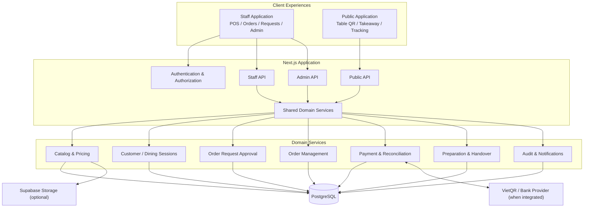
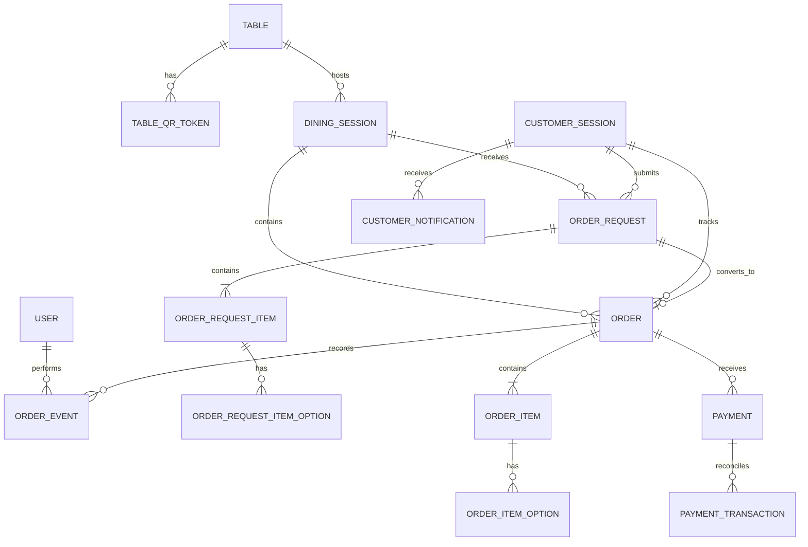
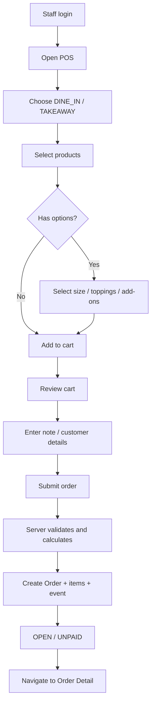
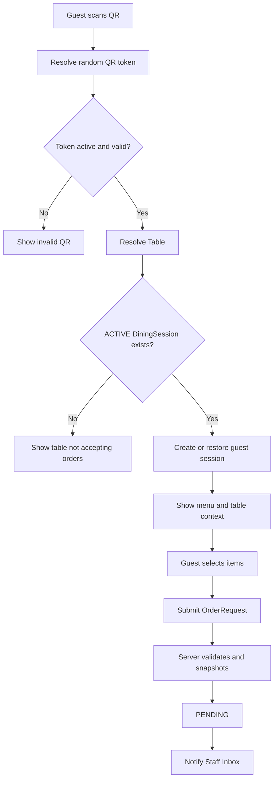
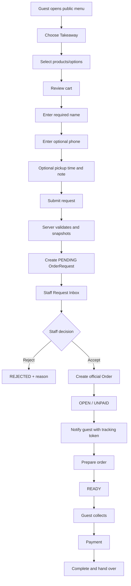

# NHIÊN POS
## Product Requirements, Architecture & AI Coding Agent Specification

**Version:** 2.0  
**Status:** Approved workflow baseline – ready for implementation planning  
**Product:** Nhiên POS – Staff-operated POS + Public Ordering  
**Primary language:** Vietnamese UI  
**Currency:** VND (integer amounts)  
**Architecture:** Next.js App Router + PostgreSQL + Prisma

---

# 1. Project Overview

Nhiên POS is an integrated point-of-sale and public-ordering platform for the Nhiên food and beverage business.

The platform supports three order-entry channels:

1. **Staff POS:** Staff create and manage orders directly.
2. **Table QR Ordering:** Guests scan a table QR code, browse the menu, and submit an order request.
3. **Takeaway Ordering:** Guests access the public menu, provide their name, optionally provide a phone number, and submit a takeaway request.

Public requests are **not official orders** until staff approve them. This is a core business rule.

The platform uses one application, one shared backend, and one transactional database. Staff and customer experiences have separate route groups, layouts, APIs, and authorization policies.

## 1.1 Product goals

- Make staff order entry fast on phones and tablets.
- Allow guests to order without creating an account.
- Support table-based ordering and takeaway ordering.
- Require staff approval before public requests become official orders.
- Keep order and payment lifecycles independent.
- Preserve financial and item snapshots for auditability.
- Support multiple rounds of ordering at the same table.
- Provide reliable cash and VietQR payment workflows.
- Provide product, category, table, staff, and reporting administration.

## 1.2 Non-goals for the initial release

- Customer membership, loyalty points, and stored customer accounts.
- Delivery fleet management and third-party delivery integrations.
- Split bills between guests.
- Kitchen Display System (KDS) and printer integrations.
- Inventory procurement and ingredient-level stock deduction.
- Multi-branch tenancy.
- Automatic bank transfer verification unless a supported provider/API is selected and tested.
- Customer editing of an already accepted order.
- Customer-initiated payment success claims.

---

# 2. Approved Business Decisions

The following decisions are approved and must be treated as requirements, not suggestions.

| Topic | Approved decision |
|---|---|
| Public ordering modes | Table QR and takeaway |
| Public request approval | Staff must approve before official Order creation/update |
| Guests at one table | Share the table's active Order |
| Public payment methods | Cash at counter and VietQR |
| Takeaway customer identity | Name required; phone optional |
| DiningSession opening | Staff opens the session when guests arrive |
| Additional order after fully paid | Create a new Order in the same DiningSession |
| Price changes while request is pending | Preserve request price snapshot while request remains pending |
| Request expiry | No automatic expiry; staff handles pending requests manually |
| Food preparation tracking | Track preparation and handover status |
| Customer account | Not required; use secure guest session |
| Database | PostgreSQL |
| ORM | Prisma |
| Application | One Next.js application with separate Staff/Public experiences |

## 2.1 Important interpretation of shared table ordering

All guests using the same table QR and active DiningSession participate in the same table session. When a request is approved:

- If the DiningSession has an eligible OPEN order, add the approved items to that order.
- If no eligible OPEN order exists, create a new order.
- If the previous order has been fully paid/completed, create a **new Order** in the same DiningSession.
- Do not reopen or mutate a completed order.
- The system must prevent two simultaneously active primary orders for the same DiningSession under the MVP shared-order policy. A new order becomes eligible after the previous order is completed/closed according to the operational rules.

This is a shared table bill, not per-guest billing.

## 2.2 Request price snapshot policy

When a guest submits a request, the server calculates and stores the item and option prices in the request snapshot.

If the product price changes while the request is still PENDING:

- Keep the submitted request price snapshot.
- Staff can approve using the snapshot price, subject to product availability and valid options.
- Staff must not silently replace the snapshot with the new catalog price.
- If a product/option becomes unavailable or cannot be fulfilled, staff rejects the request with a reason. A future customer-agreed revision workflow can be added separately.

The snapshot is not a client-supplied amount. It is calculated and persisted by the server at submission time.

---

# 3. Scope and User Roles

## 3.1 Internal users

### ADMIN
- Full access to dashboard and reports.
- Manage products, categories, option groups, and options.
- Manage staff accounts and roles.
- Manage tables and QR tokens.
- Configure store and payment settings.
- View all orders, requests, payments, and audit events.
- Perform privileged corrections according to explicit audited workflows.

### STAFF
- Use POS.
- Create and manage eligible orders.
- View and process public order requests.
- Accept or reject requests.
- Manage table sessions if granted the table-operation permission.
- Record cash payments.
- Initiate VietQR requests and perform permitted reconciliation actions.
- Update preparation and handover status.
- View operational history.
- No product, staff, payment-provider, or sensitive system configuration by default.

## 3.2 Public guest

A public guest:
- Does not have a staff account or `UserRole`.
- Receives a secure anonymous customer session.
- Can view the public menu.
- Can submit table or takeaway requests.
- Can view only requests/orders associated with their session and access token.
- Can cancel their own request only while it is PENDING.
- Cannot create an official Order directly.
- Cannot set prices, payment status, order status, staff identity, or approval metadata.
- Cannot access internal APIs or other guests' data.

Do not model `PUBLIC` as a staff `UserRole`. Use `Order.source = PUBLIC` and a `CustomerSession` identity instead.

## 3.3 Permission matrix

| Capability | ADMIN | STAFF | PUBLIC |
|---|---:|---:|---:|
| View public menu | Yes | Yes | Yes |
| Create staff POS order | Yes | Yes | No |
| Submit public OrderRequest | No | No | Yes |
| View own request/order | No | No | Yes |
| Cancel own pending request | No | No | Yes |
| View all requests | Yes | Yes | No |
| Accept/reject request | Yes | Yes | No |
| Add/edit eligible order items | Yes | Yes | No |
| Record cash payment | Yes | Yes | No |
| Initiate VietQR | Yes | Yes | No |
| Confirm provider payment | Server/provider workflow | Server/provider workflow | No |
| Manage products/categories | Yes | No | No |
| Manage staff | Yes | No | No |
| Manage tables/QR | Yes | Permission-based | No |
| View financial reports | Yes | Permission-based | No |
| Change payment provider settings | Yes | No | No |

All authorization must be enforced server-side. Hiding UI controls is not authorization.

---

# 4. System Architecture

## 4.1 High-level architecture



## 4.2 Architecture principles

- One Next.js codebase and shared PostgreSQL database.
- Separate route groups and layouts for staff, admin, and public experiences.
- Separate Public, Staff, and Admin API namespaces.
- Shared domain services for products, orders, payments, and pricing.
- Public APIs must never call internal endpoints with elevated privileges from the browser.
- Use server-side transactions for order/request/payment state changes.
- Database is the source of truth. Polling or realtime only transports updates.
- Keep payment provider integration behind an adapter interface.
- Keep customer session identity separate from staff authentication.

## 4.3 Route groups

```text
src/app/
  (auth)/
    login/

  (staff)/
    order/
    orders/
    orders/[id]/
    requests/
    requests/[id]/
    payment/[id]/
    history/

  (admin)/
    admin/
      dashboard/
      products/
      products/new/
      products/[id]/
      categories/
      tables/
      tables/[id]/
      reports/
      settings/
      staff/

  (public)/
    menu/
      page.tsx
      table/[token]/
      takeaway/
      cart/
      checkout/
      request/[token]/
      order/[token]/

  api/
    public/v1/
    staff/v1/
    admin/v1/
    webhooks/
    health/
```

The exact route layout can be adjusted to avoid duplicate route conflicts, but the experience and authorization separation must remain.

---

# 5. Technology Stack

Use current stable, mutually compatible versions at implementation time. Do not blindly pin outdated versions.

| Layer | Technology |
|---|---|
| Framework | Next.js App Router |
| Language | TypeScript strict |
| Runtime | Node.js LTS |
| Package manager | npm |
| Styling | Tailwind CSS |
| UI components | shadcn/ui |
| Icons | Lucide React |
| Motion | Motion |
| Client state | Zustand |
| Server state | TanStack Query |
| Forms | React Hook Form |
| Validation | Zod |
| Database | PostgreSQL |
| ORM | Prisma |
| Storage | Supabase Storage (optional) |
| Charts | Recharts |
| Date utilities | date-fns |
| Unit/integration tests | Vitest or Jest + Testing Library |
| E2E | Playwright |
| Deployment | Vercel or compatible Node hosting |
| Monitoring | Sentry (optional) |

Do not add Ant Design or MUI alongside shadcn/ui in the MVP. Avoid unnecessary dependencies.

---

# 6. UX, Visual Design and Responsive Rules

## 6.1 Visual direction

Style: **Modern Street Food – Minimal & Warm**.

Reference: Yumly Food Delivery UI Kit  
https://sazzadislamshohag.itch.io/yumly-food-delivery-mobile-ui-kit

Use the reference for food imagery, product cards, category navigation, product detail patterns, and warm visual language. Adapt it to POS and public ordering. Do not copy customer checkout patterns into staff POS where they do not fit.

Suggested palette:
- Cream: `#F8F5EF`
- Terracotta: `#B65C3A`
- Brown: `#453B32`
- Olive: `#82916A`
- White: `#FFFFFF`

## 6.2 Breakpoints

- Mobile: `< 768px`
- Tablet: `768px – 1199px`
- Desktop: `>= 1200px`

## 6.3 Staff POS layout

Mobile:
- Product grid: 2 columns.
- Category horizontal scrolling.
- Sticky cart summary at bottom.
- Cart opens as bottom sheet.
- Product detail uses full-screen or near-full-screen sheet.
- Respect safe areas and keyboard behavior.

Tablet:
- Product grid: 3–4 columns.
- Cart panel on the right.
- Persistent category navigation.
- Large touch targets.

Desktop:
- Optional sidebar.
- Product grid and cart side-by-side.
- Dense but readable order tables.

## 6.4 Public menu layout

- Mobile-first.
- Clear store and table context.
- Category horizontal scrolling.
- Food imagery and readable prices.
- Large add-to-cart controls.
- Sticky cart CTA.
- Checkout form with minimal fields.
- Request/order tracking page.
- Never expose internal staff navigation.

## 6.5 Accessibility and interaction

- Minimum comfortable touch target around 44px.
- Visible loading, empty, error, disabled, and success states.
- Prevent accidental duplicate submissions.
- Confirm destructive actions.
- Avoid horizontal overflow at 360px viewport width.
- Forms must remain usable with mobile keyboard open.

---

# 7. Core Domain Model and Database

Use PostgreSQL and Prisma. The following is the target domain model. It is a specification, not a copy-paste-complete Prisma schema. The coding agent must reconcile relations, optionality, indexes, constraints, and migrations against the existing repository.

## 7.1 Core entities

### User
- `id`
- `name`
- `username` or `email`
- `passwordHash` or external auth identity
- `role`: ADMIN / STAFF
- `isActive`
- `lastLoginAt`
- timestamps

### Category
- `id`
- `name`
- `slug`
- `description`
- `imageUrl`
- `sortOrder`
- `isActive`
- `archivedAt`
- timestamps

### Product
- `id`
- `categoryId`
- `name`
- `slug`
- `description`
- `imageUrl`
- `price` (integer VND)
- `costPrice` (optional integer VND)
- `isActive`
- `isAvailable`
- `sortOrder`
- `archivedAt`
- timestamps

### ProductOptionGroup
- `id`
- `productId`
- `name`
- `selectionType`: SINGLE / MULTIPLE
- `isRequired`
- `minSelections`
- `maxSelections`
- `sortOrder`
- `isActive`

### ProductOption
- `id`
- `groupId`
- `name`
- `additionalPrice` (integer VND)
- `isActive`
- `sortOrder`

### CustomerSession
- `id`
- `tokenHash` (unique; never store raw bearer token)
- `status`: ACTIVE / EXPIRED / REVOKED
- `customerName` (optional)
- `customerPhone` (optional)
- `expiresAt`
- `lastActiveAt`
- timestamps

A guest session is anonymous and does not require a customer account. Session cookie should be HttpOnly, Secure in production, and use an appropriate SameSite policy.

### Table
- `id`
- `code` (unique, e.g. T01)
- `name`
- `capacity` (optional)
- `isActive`
- timestamps

### TableQrToken
- `id`
- `tableId`
- `tokenHash` (unique)
- `isActive`
- `expiresAt` (optional)
- `revokedAt`
- timestamps

QR tokens should be random and unguessable. The server resolves the token to a table. Do not trust a client-supplied table ID.

### DiningSession
- `id`
- `tableId`
- `status`: ACTIVE / CLOSING / CLOSED
- `openedAt`
- `closedAt`
- `openedById`
- `closedById`
- timestamps

A staff member opens the DiningSession when guests arrive. A table may have at most one ACTIVE session. Enforce this with a PostgreSQL partial unique index or equivalent safe database constraint.

### OrderRequest
- `id`
- `requestNumber` (unique)
- `status`: PENDING / ACCEPTED / REJECTED / CANCELLED
- `orderType`: DINE_IN / TAKEAWAY
- `source`: PUBLIC
- `customerSessionId`
- `diningSessionId` (nullable for takeaway)
- `customerName`
- `customerPhone`
- `customerNote`
- `requestedTotal` (server-calculated integer VND snapshot)
- `acceptedOrderId` (nullable, unique)
- `reviewedById`
- `reviewedAt`
- `rejectionReason`
- `createdAt`
- `updatedAt`

There is intentionally no automatic expiry in the approved workflow. Staff manually processes pending requests. An optional manual cancellation or admin cleanup policy can be added later, but must not silently expire requests.

### OrderRequestItem
- `id`
- `requestId`
- `productId` (nullable to preserve historical snapshot if product later archived)
- `productNameSnapshot`
- `unitPriceSnapshot`
- `quantity`
- `note`
- `lineSubtotal`

### OrderRequestItemOption
- `id`
- `requestItemId`
- `productOptionId` (nullable)
- `optionGroupNameSnapshot`
- `optionNameSnapshot`
- `additionalPriceSnapshot`
- `quantity` (if option quantity is supported)

### Order
- `id`
- `orderNumber` (unique)
- `source`: STAFF / PUBLIC
- `orderType`: DINE_IN / TAKEAWAY
- `status`: OPEN / COMPLETED / CANCELLED
- `paymentStatus`: UNPAID / PENDING / PARTIALLY_PAID / PAID / OVERPAID / REFUNDED
- `fulfillmentStatus`: NOT_STARTED / PREPARING / READY / HANDED_OVER
- `diningSessionId` (nullable)
- `customerSessionId` (nullable)
- `customerName` (nullable)
- `customerPhone` (nullable)
- `subtotalAmount`
- `discountAmount`
- `totalAmount`
- `paidAmount`
- `remainingAmount`
- `createdById` (nullable when public-origin order is created by system approval; store actor separately in audit)
- `completedAt`
- `cancelledAt`
- `cancelledById`
- `cancelReason`
- `version` (integer for optimistic concurrency)
- timestamps

For public-origin orders, preserve the staff approver in `OrderEvent`/audit and `OrderRequest.reviewedById`.

### OrderItem
- `id`
- `orderId`
- `productId` (nullable)
- `productNameSnapshot`
- `unitPriceSnapshot`
- `quantity`
- `lineSubtotal`
- `note`
- timestamps

### OrderItemOption
- `id`
- `orderItemId`
- `productOptionId` (nullable)
- `optionGroupNameSnapshot`
- `optionNameSnapshot`
- `additionalPriceSnapshot`
- optional quantity

### Payment
- `id`
- `orderId`
- `method`: CASH / VIETQR
- `status`
- `amount` (integer VND)
- `reference` (unique)
- `provider`
- `providerPaymentId`
- `createdById`
- `confirmedById`
- `expiresAt`
- metadata
- timestamps

Support multiple payments and partial payments in the schema. The initial UI may default to collecting the full remaining balance.

### PaymentTransaction
- `id`
- `paymentId` (nullable until matched)
- `provider`
- `providerTransactionId`
- `transactionReference`
- `amount`
- `currency`
- `direction`
- `rawPayload` (minimize sensitive data)
- `occurredAt`
- `receivedAt`
- `reconciliationStatus`
- timestamps

Enforce uniqueness for provider transaction identity, normally `(provider, providerTransactionId)`.

### OrderEvent
Append-only order audit:
- `id`
- `orderId`
- `actorType`: STAFF / CUSTOMER / SYSTEM / PROVIDER
- `actorId`
- `eventType`
- `description`
- `metadata` JSON
- `createdAt`

### CustomerNotification
- `id`
- `customerSessionId`
- `requestId` (optional)
- `orderId` (optional)
- `type`
- `title`
- `message`
- `readAt`
- `createdAt`

### StoreSetting
- store name, logo, address, phone
- currency
- receiving bank/account details
- VietQR template/provider settings
- receipt settings
- order settings
- updatedAt

Never return secrets to the browser. Store provider secrets in server-only environment variables or a secure secret store. Avoid placing sensitive bank/provider credentials in a public settings API.

## 7.2 Relationships



## 7.3 Important database constraints

- Unique order number.
- Unique request number.
- Unique payment reference.
- Unique provider transaction identity.
- One accepted Order per OrderRequest.
- At most one ACTIVE DiningSession per Table.
- Positive item quantity.
- Non-negative integer monetary values.
- At least one item in a submitted request and a created order.
- Prevent duplicate approval using row locking or compare-and-swap state transition.
- No hard delete for financial records, accepted requests, or historical order items.
- Use foreign keys and indexes for common filtering paths.
- Use a transaction when accepting a request and creating/updating an Order.
- Use a transaction when applying payment and updating order balance.
- Consider a database constraint or transactional invariant to ensure only one eligible OPEN table order at a time.

---

# 8. State Models

## 8.1 OrderRequestStatus

```text
PENDING
  ├── ACCEPTED
  ├── REJECTED
  └── CANCELLED
```

There is no automatic EXPIRED transition in the approved workflow.

- PENDING: waiting for staff review.
- ACCEPTED: successfully converted into or applied to an official Order.
- REJECTED: staff refused the request; reason required.
- CANCELLED: guest cancelled while PENDING, or an authorized staff member cancelled it under an audited policy.

Accepted/rejected/cancelled requests are immutable in their final decision. A new guest request is required for another attempt.

## 8.2 OrderStatus

```text
OPEN
  ├── COMPLETED
  └── CANCELLED
```

Order status is independent of payment status and fulfillment status.

## 8.3 PaymentStatus

- UNPAID
- PENDING
- PARTIALLY_PAID
- PAID
- OVERPAID
- REFUNDED

Derive or update this state from successful payments, pending attempts, refunds, and remaining balance. Do not accept a browser-supplied payment status.

## 8.4 FulfillmentStatus

- NOT_STARTED
- PREPARING
- READY
- HANDED_OVER

This tracks preparation and handover. It must not be confused with OrderStatus or PaymentStatus.

## 8.5 DiningSessionStatus

- ACTIVE
- CLOSING
- CLOSED

A staff member opens the session when guests arrive. Before closing, staff must resolve pending requests and open orders. Old table QR tokens must not create requests into a closed session.

---

# 9. Staff POS Workflow

## 9.1 Create order



Server rules:
1. Validate staff session and permission.
2. Validate product and option availability.
3. Calculate all prices server-side.
4. Snapshot names and prices.
5. Generate unique order number.
6. Create order and items in one transaction.
7. Create audit event.
8. Return order detail.

Do not create a payment QR during order creation.

## 9.2 Add items to an existing order

- Staff opens an eligible OPEN order.
- Staff selects Add Items.
- POS opens in existing-order mode.
- Staff selects products/options/quantities.
- Server validates and recalculates.
- Keep the same Order ID and Order Number.
- Existing item snapshots remain unchanged.
- New items use current catalog prices at the time of addition.
- Record `ORDER_ITEM_ADDED` and relevant events.
- Use `version`/optimistic concurrency to prevent overwriting simultaneous changes.

If the order has a pending VietQR attempt and its outstanding amount changes:
- Mark the old attempt `SUPERSEDED`.
- Keep the old attempt and reference for reconciliation.
- A new QR attempt may be created for the current remaining amount.
- Late incoming transactions against the old reference must still be recorded and reconciled.
- Handle duplicate, mismatched, and overpaid transactions explicitly.

## 9.3 Edit/remove items

- Allowed only while Order is OPEN and according to permission.
- Validate all changes on the server.
- Recalculate totals in a transaction.
- Preserve audit history.
- Never hard-delete financial history.
- Block ordinary edits after COMPLETED or CANCELLED.

## 9.4 Cancel order

- Only eligible OPEN orders can be cancelled through normal staff flow.
- Require confirmation and reason.
- Record actor and timestamp.
- Do not erase successful payments.
- Paid orders require a separate refund/reconciliation workflow.
- Update DiningSession eligibility if the order was its active order.

---

# 10. Public Table QR Workflow

## 10.1 Staff opens the table session

1. Staff opens Table Management.
2. Selects an available table.
3. Starts a DiningSession.
4. Server checks there is no other ACTIVE session for that table.
5. Store `openedById` and `openedAt`.
6. Table becomes occupied/active.
7. The printed table QR can now resolve to the active session.

The guest does not open the DiningSession. Staff must open it when guests arrive.

## 10.2 Guest scans table QR



Security:
- Do not accept a raw `tableId` as proof of table access.
- Resolve random QR token server-side.
- Guest session token is random and stored as a hash server-side.
- Guest can access only their own request/order data.
- A table QR is not proof of physical presence; use staff approval as the operational control.

## 10.3 Multiple guests at one table

Approved policy: shared table Order.

When staff approves a request:
1. Lock or safely version-check the DiningSession.
2. Confirm the session is ACTIVE.
3. Find the eligible OPEN Order for the session.
4. If found, append approved request items to that Order.
5. If not found, create a new Order.
6. Link the OrderRequest to the resulting Order.
7. Mark the request ACCEPTED.
8. Record approver and event.
9. Notify the customer session.

The system must not create separate bills per guest in the MVP.

## 10.4 Additional request after the table Order is paid

If the current table Order has been fully paid and completed:
- Do not reopen it.
- A new public request may still be submitted while the DiningSession is ACTIVE.
- On staff approval, create a new Order within the same DiningSession.
- The new Order gets a new Order Number and a new payment lifecycle.
- The previous completed Order remains immutable.

## 10.5 Close table session

Before closing:
- Resolve or explicitly reject/cancel pending requests.
- Ensure all Orders in the DiningSession are completed or explicitly handled.
- Staff confirms close.
- Set DiningSession CLOSED and `closedAt`/`closedById`.
- Old session cannot receive new requests.
- Table becomes available for the next guests.

---

# 11. Public Takeaway Workflow

## 11.1 Guest flow



## 11.2 Required fields

- Customer name: required.
- Customer phone: optional.
- Pickup time: optional.
- Customer note: optional.
- At least one valid item: required.

The guest does not need to register or log in.

## 11.3 Tracking

After request submission, guest receives a secure tracking URL/token.

Before acceptance:
- Show request number and PENDING status.
- Show cancellation action while PENDING.

After acceptance:
- Show official order number.
- Show current fulfillment and payment statuses.
- Do not expose staff-only notes, internal audit data, or other customers' information.

---

# 12. Staff Request Inbox and Approval Workflow

This is a core screen for Public Ordering.

## 12.1 Inbox tabs

- Pending: all requests awaiting staff action.
- Processed: accepted, rejected, or cancelled requests.
- No automatic expired tab is required because requests do not expire automatically.

Each request card should show:
- Request number.
- Source: TABLE QR / TAKEAWAY.
- Table code, if DINE_IN.
- Customer name and optional phone.
- Items, options, quantities, and notes.
- Submitted price snapshot.
- Request creation time.
- Staff actions.

## 12.2 Accept request

Endpoint concept:

```http
POST /api/staff/v1/order-requests/{id}/accept
```

The server must:
1. Authenticate staff and check permission.
2. Begin a database transaction.
3. Lock request row or perform compare-and-swap update.
4. Verify request is still PENDING.
5. Verify customer request has valid items and snapshots.
6. Verify products/options remain fulfillable.
7. Preserve the server-created request price snapshot.
8. For DINE_IN, verify DiningSession remains ACTIVE.
9. Find eligible OPEN Order for that DiningSession.
10. Append items to eligible order or create a new order.
11. Recalculate totals.
12. Set `acceptedOrderId`, `reviewedById`, `reviewedAt`, status ACCEPTED.
13. Record OrderEvent/audit.
14. Create customer notification.
15. Commit transaction.

If any required step fails, rollback the transaction.

Use idempotency and concurrency protection. A second approval must return a conflict and must not create a duplicate Order or duplicate items.

## 12.3 Reject request

Endpoint concept:

```http
POST /api/staff/v1/order-requests/{id}/reject
```

Request:

```json
{
  "reason": "Món đã hết nguyên liệu"
}
```

Rules:
- Request must be PENDING.
- Reason is required.
- Store reviewer and timestamp.
- Do not create an Order.
- Notify the guest.
- Preserve the request for history and reporting.

## 12.4 Customer cancellation

Endpoint concept:

```http
POST /api/public/v1/order-requests/{token}/cancel
```

Rules:
- Only the owner session may cancel.
- Only while status is PENDING.
- If already ACCEPTED, the customer cannot cancel the request; they must contact staff and staff uses the order cancellation workflow.
- Cancellation must be idempotent and audited.

## 12.5 Price snapshot policy

- `requestedTotal` and item prices are calculated on the server when request is submitted.
- Keep snapshot prices while request is pending.
- If catalog price changes, staff may approve using the original snapshot.
- If a product/option becomes unavailable, staff rejects with a reason.
- Do not silently modify the guest's submitted price.
- Customer-agreed revisions are a future enhancement, not required for MVP.

## 12.6 Pending request handling

There is no automatic expiry. Staff must process pending requests manually.

The UI should:
- Highlight pending requests.
- Show elapsed waiting time.
- Provide sound/visual notification.
- Allow filtering and sorting by oldest/newest.
- Warn before closing a DiningSession with pending requests.
- Provide a manual reject/cancel decision with reason.

---

# 13. Order Fulfillment and Preparation

Track preparation independently from order and payment status.

## 13.1 FulfillmentStatus

- `NOT_STARTED`
- `PREPARING`
- `READY`
- `HANDED_OVER`

## 13.2 Workflow

1. Staff accepts public request and official Order is created/updated.
2. Staff or authorized operator marks order PREPARING.
3. When all items are ready, mark READY.
4. For takeaway, staff hands the order to the guest and marks HANDED_OVER.
5. For dine-in, staff can use READY to indicate preparation completion; HANDED_OVER may represent delivery to the table if operationally useful.

The MVP does not require a separate KDS. Status controls can live in Order Detail and the Orders list.

Order may remain OPEN while fulfillment is READY or HANDED_OVER if payment or service is not yet complete.

Completion rules:
- Staff completes an order when service is finished and payment policy is satisfied.
- Do not automatically complete solely because fulfillment is READY.
- Do not automatically mark PAID based on fulfillment status.

---

# 14. Payment and VietQR

## 14.1 Payment rules

- Order and Payment are separate entities.
- One Order may have multiple Payment records.
- Support partial payment in the schema.
- MVP UI can default to collecting the full remaining amount.
- `remainingAmount = totalAmount - successfulPayments + applicable refunds/adjustments` according to the finalized accounting model.
- Server calculates all balances.
- No browser action can set Payment to SUCCEEDED or Order to PAID.

## 14.2 Cash workflow

1. Staff opens Order Detail.
2. Selects Payment → CASH.
3. Server returns current remaining balance.
4. Staff enters amount received.
5. UI calculates change.
6. Staff confirms.
7. Server validates amount and current balance.
8. Server creates successful cash Payment and updates order balance in a transaction.
9. Store `createdById`, `confirmedById`, timestamps, and idempotency key.
10. Update payment status and audit.

Prevent double submission. If cash received is greater than outstanding amount, calculate change and record only the amount applied to the order, while retaining received/change details as needed for cash reconciliation. Do not accidentally mark the order OVERPAID merely because the guest hands over a larger banknote and receives change.

## 14.3 VietQR workflow

1. Staff selects VietQR.
2. Server calculates current remaining amount.
3. Server creates a Payment attempt with unique reference.
4. QR is generated using configured bank/provider integration.
5. Show QR, amount, bank/account details, and reference.
6. Payment remains pending.
7. Provider webhook or trusted reconciliation process reports transaction.
8. Verify signature/authentication, provider transaction ID, reference, amount, currency, and direction.
9. Apply idempotency.
10. Record transaction and update payment/order balances atomically.
11. Notify staff/customer as appropriate.

Important:
- A QR image is only a payment request.
- A screenshot from a guest is not authoritative payment confirmation.
- UI polling may refresh server-verified state but is not proof of payment.
- If no provider API/webhook is available, use explicit manual reconciliation by authorized staff and record who reconciled it.
- Do not claim automatic payment verification until a real provider integration has been tested.

## 14.4 Superseded QR after order changes

If a pending QR exists and the order amount changes:
- Mark old attempt `SUPERSEDED`.
- Preserve its reference and metadata.
- Create a new attempt for the current outstanding amount when requested.
- Late transactions on old references must still be ingested and reconciled.
- Match by provider transaction identity and reference.
- If an old transaction is valid, record it against the order.
- If amount exceeds outstanding, flag overpayment and require reconciliation/refund handling.
- Never discard a real transaction merely because the associated QR was superseded.

## 14.5 Public payment

Approved methods:
- Cash at counter.
- VietQR.

The public guest does not mark payment as successful. Staff or a verified provider workflow records payment. For the initial release, show payment instructions/status to the guest, while the staff application remains the operational authority.

## 14.6 Provider adapter

Define an interface such as:

```ts
interface PaymentProvider {
  createPaymentRequest(input: CreatePaymentRequestInput): Promise<PaymentRequestResult>;
  verifyWebhook(input: WebhookInput): Promise<VerifiedWebhookResult>;
  reconcileTransaction(input: ReconcileInput): Promise<ReconciliationResult>;
  getPaymentStatus?(reference: string): Promise<ProviderPaymentStatus>;
}
```

Do not invent provider endpoints, signatures, or API fields. Select a real provider and follow its official documentation before implementation.

---

# 15. Table and DiningSession Management

## 15.1 Table admin

Fields:
- Table code.
- Table name.
- Capacity (optional).
- Active/inactive.
- QR token state.
- Current DiningSession.
- Current open Order.
- Pending request count.

MVP can use a table list; a visual floor plan is optional future work.

## 15.2 Table QR

- Generate random high-entropy token.
- Store only token hash where practical.
- QR URL resolves token server-side.
- Allow ADMIN to revoke/regenerate token.
- Revoking old QR immediately prevents new session resolution.
- Do not expose internal database IDs as security tokens.

## 15.3 DiningSession operations

### Open
- Staff selects an available table.
- Server ensures no ACTIVE session exists.
- Creates DiningSession.
- Stores opener and timestamp.
- Table becomes occupied.

### Close
- Staff initiates close.
- System checks pending requests and open orders.
- Require staff to resolve outstanding requests.
- Require all orders to be completed/cancelled or explicitly handled.
- Close session with actor and timestamp.
- Old session no longer accepts requests.
- Table becomes available.

---

# 16. Admin Workflows

## 16.1 Dashboard

Show:
- Gross order value.
- Collected revenue.
- Outstanding balance.
- Order count.
- Average order value.
- Open/unpaid orders.
- Revenue by source (STAFF/PUBLIC).
- Revenue by order type (DINE_IN/TAKEAWAY).
- Payment split.
- Best-selling products.
- Pending public requests.
- Request acceptance/rejection counts.

Do not count PENDING or REJECTED OrderRequests as revenue. Do not count unpaid order value as collected revenue. Exclude cancelled orders from normal sales metrics, while preserving audit/refund history.

## 16.2 Product management

- Create/edit/archive products.
- Set price and optional cost price.
- Upload image.
- Assign category.
- Configure option groups and options.
- Activate/deactivate.
- Set availability separately from active status.
- Sort products.
- Search/filter.

Never hard-delete products referenced by historical orders or requests.

## 16.3 Category management

- Create/edit/archive.
- Name, image/icon, description.
- Sort order.
- Active status.
- Product count.

## 16.4 Staff management

- Create staff account.
- Activate/deactivate.
- Assign role/permissions.
- Reset credentials through secure flow.
- Record last login.
- Do not expose password hashes.

## 16.5 Reports

- Revenue by day/week/month.
- Order count and AOV.
- Top products.
- Revenue by category.
- Revenue by payment method.
- Revenue by source.
- Revenue by order type.
- Outstanding orders.
- Staff performance.
- Public request conversion/acceptance rate.
- CSV/Excel export can be added after MVP.

## 16.6 Settings

- Store name/logo/address/contact.
- Currency VND.
- Bank receiving information.
- VietQR provider configuration.
- Staff/permission settings.
- Receipt settings (future).
- Order numbering and operational settings.
- Security and audit configuration.

---

# 17. API Specification

Use versioned namespaces and validate every input with Zod.

## 17.1 Public API

Prefix: `/api/public/v1`

| Method | Endpoint | Purpose |
|---|---|---|
| GET | `/store` | Public store information |
| GET | `/menu` | Active public menu |
| GET | `/menu/products/:id` | Product detail/options |
| POST | `/sessions` | Create/restore guest session |
| GET | `/tables/resolve/:token` | Resolve QR token and active session |
| POST | `/order-requests` | Submit request |
| GET | `/order-requests` | List own session requests |
| GET | `/order-requests/:token` | Track own request |
| POST | `/order-requests/:token/cancel` | Cancel own pending request |
| GET | `/orders/:token` | Track accepted order |
| GET | `/notifications` | Own notifications |
| POST | `/notifications/:id/read` | Mark own notification read |

Use opaque random tracking tokens or session-bound identifiers. Do not rely on sequential IDs.

## 17.2 Staff API

Prefix: `/api/staff/v1`

| Method | Endpoint | Purpose |
|---|---|---|
| GET | `/order-requests` | List requests |
| GET | `/order-requests/:id` | Request detail |
| POST | `/order-requests/:id/accept` | Approve request |
| POST | `/order-requests/:id/reject` | Reject request |
| GET | `/orders` | List orders |
| POST | `/orders` | Create staff order |
| GET | `/orders/:id` | Order detail |
| POST | `/orders/:id/items` | Add items |
| PATCH | `/orders/:id/items/:itemId` | Edit item |
| DELETE | `/orders/:id/items/:itemId` | Remove item |
| POST | `/orders/:id/cancel` | Cancel order |
| POST | `/orders/:id/complete` | Complete order |
| PATCH | `/orders/:id/fulfillment` | Update preparation status |
| POST | `/orders/:id/payments/cash` | Record cash payment |
| POST | `/orders/:id/payments/vietqr` | Create VietQR attempt |
| GET | `/payments/:id` | Payment detail |
| POST | `/payments/:id/reconcile` | Authorized manual reconciliation |
| GET | `/tables` | Table list |
| POST | `/tables/:id/open-session` | Open DiningSession |
| POST | `/tables/:id/close-session` | Close DiningSession |

## 17.3 Admin API

Prefix: `/api/admin/v1`

CRUD endpoints for:
- Products.
- Categories.
- Product option groups/options.
- Tables and QR tokens.
- Staff users and permissions.
- Store settings.
- Reports.

Every Admin endpoint must verify ADMIN or an explicit permission.

## 17.4 Webhooks

Prefix: `/api/webhooks/payments/:provider`

- Verify provider signature/authentication.
- Validate payload schema.
- Apply idempotency.
- Persist transaction identity.
- Reconcile reference and amount.
- Respond according to provider retry requirements.
- Never trust arbitrary webhook payload without verification.

## 17.5 API conventions

- Consistent response envelope.
- Correct HTTP status codes.
- Zod validation.
- Server-side authorization.
- Idempotency key for create/confirm operations.
- Optimistic concurrency via `version` or conditional update.
- Do not expose stack traces or secrets.
- Log correlation/request IDs.

---

# 18. Security and Data Integrity

## 18.1 Authentication

- Staff authentication with secure sessions.
- HTTP-only cookies.
- Secure cookies in production.
- SameSite policy appropriate to deployment.
- Password hashing with a modern password hashing algorithm if password auth is used.
- Rate limiting for login.
- Deactivate staff sessions when accounts are disabled where supported.

## 18.2 Public guest sessions

- High-entropy random session token.
- Store token hash server-side.
- HttpOnly, Secure in production, SameSite cookie.
- Rotate/revoke session where appropriate.
- Bind request/order access to the guest session.
- Avoid personal data in URL query strings.
- Do not expose sequential order IDs as authorization.

## 18.3 Authorization

- Server-side permission checks for every protected operation.
- Public, Staff, and Admin route namespaces.
- Never trust role or actor fields from client.
- Never expose database service credentials to browser.
- Validate ownership on every guest read/cancel operation.

## 18.4 Financial integrity

- VND amounts stored as integer.
- Never use floating point for money.
- Server calculates all totals.
- Snapshot product/option names and prices.
- Use transactions for payment and order balance changes.
- No hard deletion of financial records.
- Unique payment references and provider transaction IDs.
- Idempotent webhooks and cash confirmation.
- Audit all privileged changes.

## 18.5 Concurrency

Protect:
- Request approval.
- Adding items to an order.
- Payment confirmation.
- DiningSession open/close.
- Table's active order selection.

Use database transactions, row locks where appropriate, unique constraints, and optimistic concurrency. Return a conflict response if the resource changed since it was loaded.

## 18.6 Abuse prevention

- Rate limit public request creation.
- Limit quantity and request payload size.
- Validate product/option combinations.
- Prevent duplicate submit with idempotency.
- Avoid revealing whether another customer's request/order exists.
- Log suspicious repeated attempts.
- Consider CAPTCHA only if abuse becomes a real problem; do not add unnecessary friction by default.

---

# 19. Notifications and Realtime

## 19.1 MVP: polling

- Staff Request Inbox polls every 5–10 seconds.
- Customer tracking polls server status.
- Show pending count.
- Play optional sound for new request.
- Browser notification only with user permission.
- Use server state as source of truth.

## 19.2 Future: realtime

Potential options:
- Supabase Realtime.
- WebSocket/SSE.

Use realtime for:
- New public request.
- Request accepted/rejected.
- Order status changes.
- Fulfillment status changes.
- Payment status changes.

Realtime is a delivery mechanism, not the source of truth. A reconnecting client must fetch current server state.

---

# 20. Audit and Reporting Events

Required events include:

- ORDER_CREATED
- ORDER_ITEM_ADDED
- ORDER_ITEM_UPDATED
- ORDER_ITEM_REMOVED
- ORDER_CANCELLED
- ORDER_COMPLETED
- REQUEST_CREATED
- REQUEST_ACCEPTED
- REQUEST_REJECTED
- REQUEST_CANCELLED
- PAYMENT_CREATED
- PAYMENT_SUCCEEDED
- PAYMENT_FAILED
- PAYMENT_SUPERSEDED
- PAYMENT_RECONCILED
- DINING_SESSION_OPENED
- DINING_SESSION_CLOSED
- TABLE_QR_REVOKED
- FULFILLMENT_STATUS_CHANGED

Each event should record:
- Actor type: STAFF / CUSTOMER / SYSTEM / PROVIDER.
- Actor ID or session ID.
- Entity type and entity ID.
- Event type.
- Timestamp.
- Metadata needed for investigation.
- Correlation/request ID where applicable.

Audit records should be append-only in normal application workflows.

---

# 21. Error Handling

Expected error categories:
- Validation error.
- Unauthenticated.
- Unauthorized.
- Not found.
- Conflict/concurrent update.
- Product unavailable.
- Invalid option selection.
- Invalid/closed DiningSession.
- Request already processed.
- Request not owned by guest session.
- Payment provider failure.
- Payment mismatch/duplicate.
- Database unavailable.
- Rate limit exceeded.

User-facing messages must be clear Vietnamese. Technical logs should include structured context but must not expose passwords, tokens, secrets, or unnecessary personal data.

Examples:
- “Món này hiện không còn khả dụng.”
- “Yêu cầu này đã được nhân viên xử lý.”
- “Bàn hiện chưa mở phiên phục vụ.”
- “Đơn hàng vừa được cập nhật. Vui lòng tải lại.”
- “Chưa xác minh được giao dịch. Nhân viên sẽ kiểm tra lại.”

---

# 22. Testing and Acceptance Criteria

## 22.1 Staff POS

- Staff can log in.
- Staff can select products/options and create exactly one Order.
- Server-calculated totals are correct.
- Order starts OPEN / UNPAID.
- Adding items keeps the same order number.
- Old item snapshots remain unchanged.
- New items use correct price snapshot.
- Completed/cancelled orders cannot be edited through normal flow.
- Concurrent edits return a conflict rather than losing data.

## 22.2 Public Table QR

- Valid QR resolves the correct table.
- Invalid/revoked QR is rejected.
- A table without ACTIVE DiningSession cannot accept requests.
- Staff must open the DiningSession.
- Guest can submit a multi-item request.
- Request starts PENDING.
- Staff sees request in inbox.
- Staff approval creates/updates the correct shared table Order.
- Multiple guests share the table Order.
- After previous order is completed, a new request creates a new Order in the same DiningSession.
- Guest cannot access another guest's request/order.

## 22.3 Public Takeaway

- Guest can order without account.
- Name is required.
- Phone is optional.
- Request is PENDING until staff approval.
- Staff rejection does not create an Order.
- Staff approval creates an official Order.
- Guest receives a secure tracking link.
- Guest can cancel only while PENDING.

## 22.4 Request approval

- Only PENDING request can be accepted/rejected.
- Two simultaneous approvals create only one conversion.
- Accepted request cannot be accepted again.
- Rejected request stores reason/reviewer/time.
- Pending request does not expire automatically.
- Price snapshot is preserved if catalog price changes.
- Unavailable product can be rejected with reason.
- Approval transaction is atomic.

## 22.5 Payment

- Cash received/change calculated correctly.
- Duplicate cash submission is prevented.
- VietQR attempt uses current outstanding amount.
- QR creation does not mark payment successful.
- Provider signature and transaction identity are verified.
- Duplicate webhook is idempotent.
- Superseded QR remains reconcilable.
- Late payment is recorded.
- Overpayment is flagged.
- Paid amount and remaining amount are server-calculated.

## 22.6 Fulfillment and table operations

- Staff can update PREPARING, READY, HANDED_OVER.
- Fulfillment does not automatically mark payment paid.
- Table cannot have two ACTIVE DiningSessions.
- Closing session warns about pending requests/open orders.
- Closed session cannot receive new requests.
- Old QR cannot attach a request to a new/closed session incorrectly.

## 22.7 Responsive QA

- 360px mobile width without horizontal overflow.
- Product cards and cart remain usable.
- Touch targets are comfortable.
- Tablet layout supports product grid and right cart panel.
- Sheets respect viewport and safe areas.
- Public menu and checkout work on mobile Safari/Chrome.
- Staff screens are usable on tablet.

---

# 23. Implementation Roadmap

## Phase 0 – Foundation
- Inspect repository and current code.
- Set up Next.js, TypeScript strict, Tailwind, shadcn/ui.
- Configure env validation.
- Configure PostgreSQL and Prisma.
- Implement authentication and permission foundation.
- Create design tokens and application layouts.
- Establish lint, typecheck, test commands.

## Phase 1 – Catalog and Staff POS
- Category/product schema and seed.
- Product APIs.
- POS UI.
- Product options.
- Zustand POS cart.
- Server-side pricing.
- Responsive mobile/tablet layout.

## Phase 2 – Order Management
- Order and item schema.
- Order number generation.
- Create/list/detail.
- Add/edit/remove items.
- Order events.
- Optimistic concurrency.
- Cancellation/completion.

## Phase 3 – Payments
- Payment schema.
- Cash payment.
- Payment adapter.
- VietQR provider selection and integration.
- Webhook/reconciliation.
- Superseded attempts and late transaction handling.
- Payment history.

## Phase 4 – Operations and Admin
- Order history.
- Fulfillment status.
- Dashboard.
- Product/category/options management.
- Staff management.
- Settings and reports.

## Phase 5 – Table Management
- Table CRUD.
- QR token generation/revocation.
- DiningSession open/close.
- Table status.
- Active Order association.

## Phase 6 – Public Ordering
- CustomerSession.
- Public menu.
- Table QR menu.
- Takeaway menu.
- Customer cart and checkout.
- OrderRequest and request items.
- Staff Request Inbox.
- Accept/reject workflow.
- Shared table Order behavior.
- Customer tracking.

## Phase 7 – Notifications and Production Readiness
- Polling and optional realtime.
- Unit/integration/E2E tests.
- Security review.
- Responsive QA.
- Monitoring and backups.
- Deployment and smoke tests.
- Staff operating guide.

The sequence can be adjusted if a vertical slice is more efficient, but do not implement Public Ordering before the Order/Payment domain rules are stable.

---

# 24. Source Code Structure

```text
nhien-pos/
├── public/
├── prisma/
│   ├── schema.prisma
│   ├── migrations/
│   └── seed.ts
├── src/
│   ├── app/
│   │   ├── (auth)/
│   │   ├── (staff)/
│   │   ├── (admin)/
│   │   ├── (public)/
│   │   ├── api/
│   │   ├── layout.tsx
│   │   └── globals.css
│   ├── components/
│   │   ├── ui/
│   │   ├── layout/
│   │   ├── staff/
│   │   ├── customer/
│   │   └── shared/
│   ├── features/
│   │   ├── auth/
│   │   ├── products/
│   │   ├── categories/
│   │   ├── cart/
│   │   ├── orders/
│   │   ├── order-requests/
│   │   ├── customer-sessions/
│   │   ├── tables/
│   │   ├── dining-sessions/
│   │   ├── payments/
│   │   ├── fulfillment/
│   │   ├── notifications/
│   │   ├── reports/
│   │   └── settings/
│   ├── lib/
│   │   ├── auth/
│   │   ├── db/
│   │   ├── permissions/
│   │   ├── payments/
│   │   ├── security/
│   │   ├── validations/
│   │   └── utils/
│   ├── hooks/
│   ├── stores/
│   │   ├── pos-cart.store.ts
│   │   └── customer-cart.store.ts
│   ├── types/
│   └── config/
├── tests/
│   ├── unit/
│   ├── integration/
│   └── e2e/
├── .env.example
└── README.md
```

Use feature-oriented modules. Keep business logic out of page components. Avoid excessive abstraction.

---

# 25. Environment Variables

Example only; adapt to selected authentication and payment providers.

```dotenv
NODE_ENV=development
NEXT_PUBLIC_APP_URL=http://localhost:3000

DATABASE_URL=
DIRECT_URL=

AUTH_SECRET=

NEXT_PUBLIC_SUPABASE_URL=
NEXT_PUBLIC_SUPABASE_ANON_KEY=
SUPABASE_SERVICE_ROLE_KEY=
PRODUCT_IMAGE_BUCKET=products

PAYMENT_PROVIDER=
PAYMENT_PROVIDER_API_URL=
PAYMENT_PROVIDER_API_KEY=
PAYMENT_PROVIDER_SECRET=
PAYMENT_WEBHOOK_SECRET=

STORE_NAME=Nhiên
STORE_CURRENCY=VND
```

Rules:
- Never commit `.env`.
- Never expose server secrets through `NEXT_PUBLIC_*`.
- Validate required environment variables at startup.
- Do not invent payment-provider configuration.
- Only add variables required by the selected provider/auth solution.

---

# 26. Seed Data

Suggested categories:
- Mì trộn
- Cơm chiên
- Ăn vặt
- Cá viên
- Trà/nước
- Trà sữa
- Cà phê

Sample products (placeholders; confirm actual menu/prices):
- Mì trộn trứng xá xíu – 35,000 VND
- Cơm chiên xá xíu – 40,000 VND
- Cá viên chiên – 20,000 VND
- Trà đào – 25,000 VND
- Trà sữa – 25,000 VND
- Cà phê – 20,000 VND

Sample options:
- Trứng +5,000 VND
- Xá xíu +10,000 VND
- Xúc xích +7,000 VND

Create one development admin and one development staff account only through an explicit seed configuration. Never ship known default production credentials.

---

# 27. AI Coding Agent Instructions

## 27.1 Before coding

1. Read this README completely.
2. Inspect the repository and report:
   - Framework and version.
   - Package manager.
   - Existing folder structure.
   - Existing database/schema/migrations.
   - Existing authentication.
   - Existing conventions and tests.
3. Identify conflicts between the repository and this specification.
4. Propose a milestone plan.
5. Do not overwrite existing work without explaining the impact.
6. Ask only for decisions that are genuinely blocking implementation.

## 27.2 Coding standards

- TypeScript strict.
- Avoid `any`.
- Use Zod for input validation.
- Use Prisma migrations; do not modify production database schema manually.
- Keep business logic in feature/service modules.
- Keep server-only logic and secrets off the client.
- Calculate all money on the server using integer VND.
- Use transactions for multi-record business operations.
- Add indexes for common queries.
- Enforce unique constraints and idempotency.
- Add audit events for important operations.
- No mock data in production paths.
- Build complete loading, empty, error, and success states.
- Vietnamese UI copy.
- Do not add unnecessary dependencies.

## 27.3 Milestone execution

For each milestone:
1. State scope and acceptance criteria.
2. List files to create/change.
3. Implement a vertical slice.
4. Run typecheck.
5. Run lint.
6. Run relevant unit/integration tests.
7. Run E2E tests where appropriate.
8. Fix failures before moving on.
9. Summarize implementation, tests, risks, and remaining work.

## 27.4 Payment caution

Do not claim VietQR automatic verification works until:
- A real provider is selected.
- Official provider documentation is reviewed.
- Signature verification is implemented.
- Duplicate and late webhook tests pass.
- A real end-to-end transaction has been tested in the provider's supported environment.

## 27.5 Do not silently change approved business rules

In particular:
- Public requests require staff approval.
- Requests do not automatically expire.
- Guests at one table share an Order.
- Staff opens DiningSession.
- Fully paid/completed table Order is not reopened; a new Order is created in the same DiningSession.
- Pending request price snapshot is preserved.
- Takeaway name is required and phone is optional.
- Public payment methods are cash at counter and VietQR.
- Fulfillment status is tracked independently.

---

# 28. Final Definition of Done

The MVP is ready for operational use only when:

- Staff can log in and use POS.
- Products, categories, options, and prices are managed by Admin.
- Staff can create, edit, complete, and cancel eligible orders.
- Order and payment state are independent and correct.
- Cash payment is idempotent and auditable.
- VietQR behavior is accurately represented; automatic verification is only enabled after real provider validation.
- Tables and DiningSessions work with QR tokens.
- Guests can submit table and takeaway requests without accounts.
- Every public request remains PENDING until staff acts.
- Staff can accept/reject requests safely.
- Accepted table requests append to the shared eligible Order.
- After a completed table Order, a new Order is created in the same DiningSession.
- Takeaway request requires a name and allows optional phone.
- Guests can track only their own requests/orders.
- Preparation status can be updated.
- Pending requests do not auto-expire.
- Audit history is retained.
- Role and ownership checks are enforced server-side.
- Mobile and tablet QA passes.
- Backups, monitoring, and deployment smoke tests are in place.

---

# Appendix A – Initial setup commands

```bash
npx create-next-app@latest nhien-pos
cd nhien-pos
```

Choose:
- TypeScript: Yes
- ESLint: Yes
- Tailwind CSS: Yes
- `src/` directory: Yes
- App Router: Yes
- Import alias: `@/*`

Suggested packages (check current compatibility before installation):

```bash
npm install zustand @tanstack/react-query
npm install react-hook-form zod @hookform/resolvers
npm install lucide-react date-fns
npm install recharts
npm install prisma @prisma/client
npm install -D tsx
```

Initialize shadcn/ui using its current official instructions. Install authentication and storage SDKs only after choosing the actual providers.

# Appendix B – Important unresolved implementation selections

These are provider/implementation choices, not unresolved business workflow decisions:

1. Authentication provider or custom session implementation.
2. VietQR/bank transaction verification provider.
3. Hosting and database connection strategy.
4. Product image storage provider.
5. Polling interval tuning and future realtime provider.
6. Receipt printer and KDS integration (future).

The coding agent must not invent these integrations. It should document options and request a decision when the choice blocks implementation.
